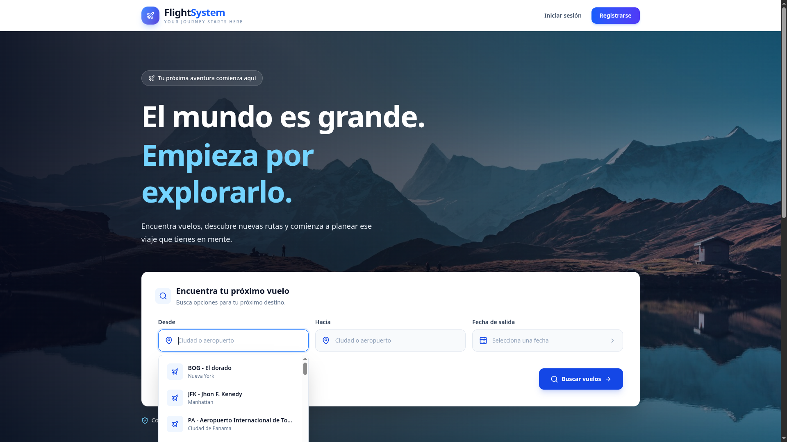
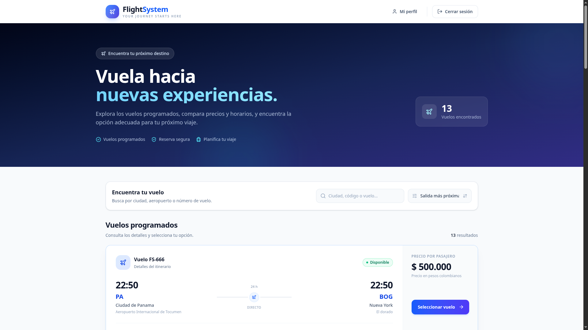
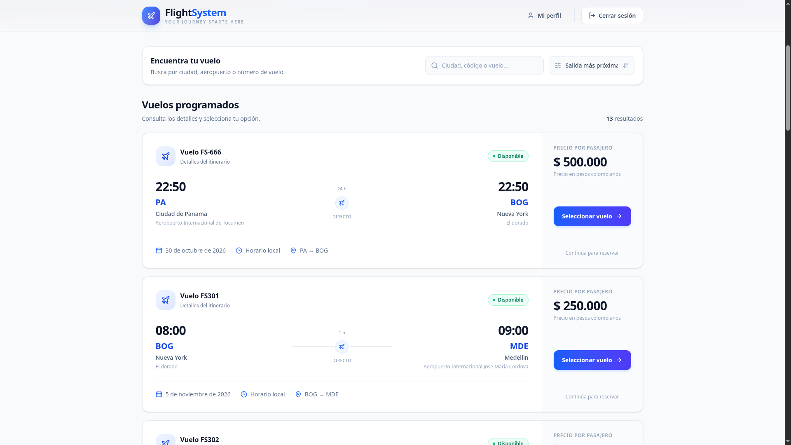
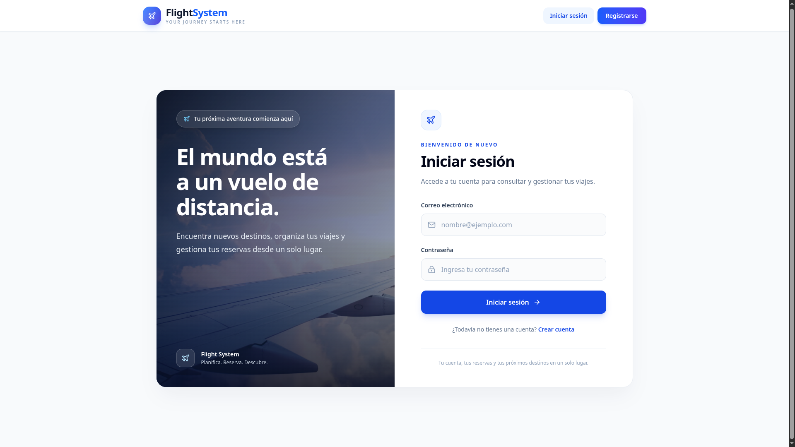
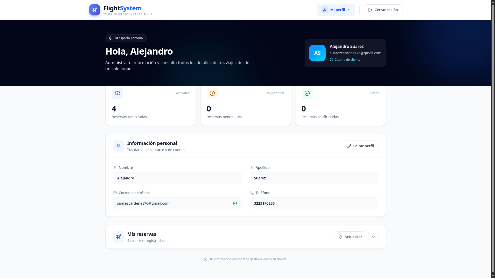
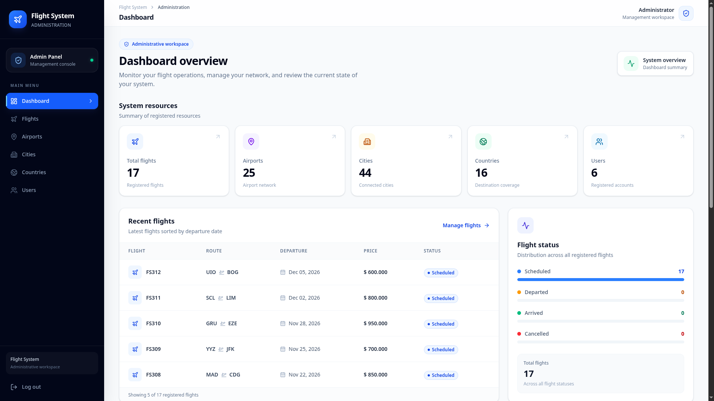
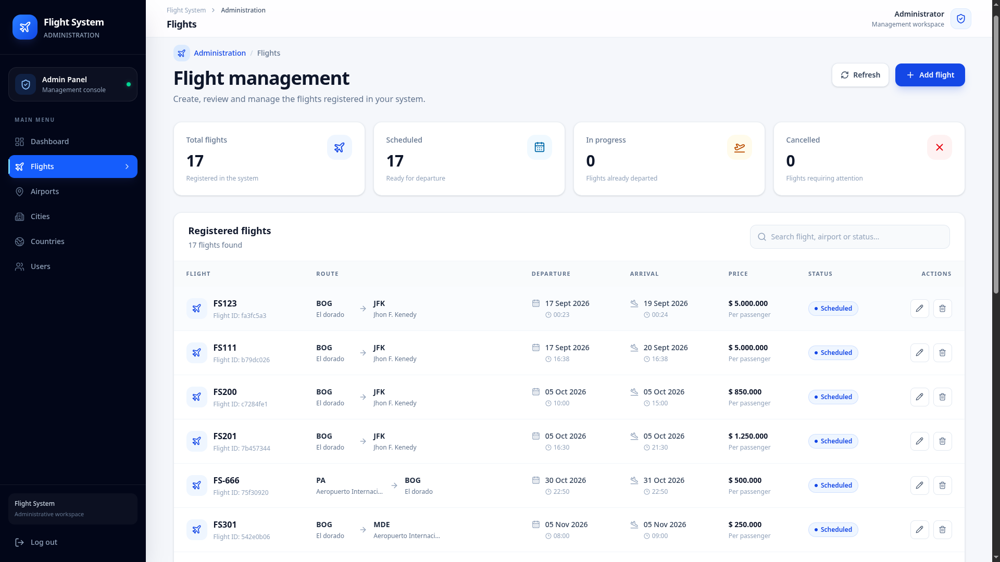
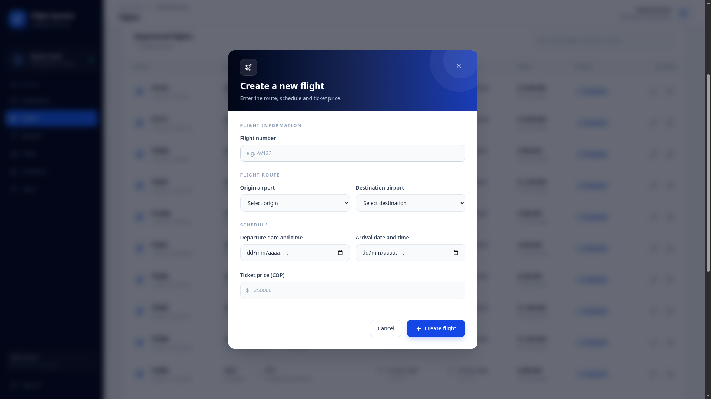
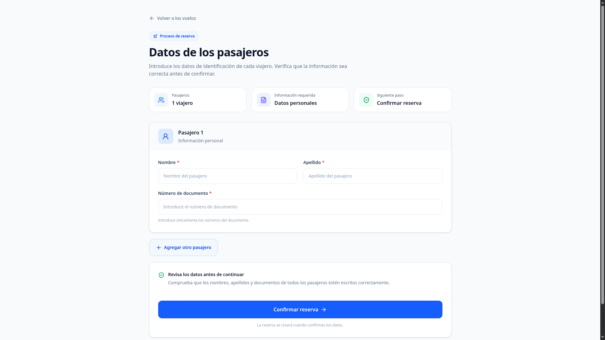

# Flight System ✈️

A full-stack flight reservation web application built with **FastAPI, PostgreSQL, React, and TypeScript**. The project focuses on backend development, REST API design, authentication, database management, and frontend integration.

## Overview

Flight System allows users to explore available flights and provides administrative tools to manage flight-related information. It is being developed as a personal portfolio project to demonstrate software development skills and backend architecture practices.

## Features

### User Features
- User registration and authentication.
- JWT-based authentication.
- Browse and search available flights.
- View and update user profile information.
- Create reservations with passenger information.

### Administrative Features
- Role-based access control for administrators and customers.
- Manage countries, cities, and airports.
- Create, view, update, and delete flights.
- Administrative dashboard.

## Screenshots

### Home Page



### Flight Search





### Authentication and Profile





### Flight Administration







### Reservations



## Technologies

### Backend
- Python 3.13
- FastAPI
- PostgreSQL
- SQLAlchemy 2.0 with asynchronous database access
- Alembic
- Pydantic
- JWT authentication
- Passlib and bcrypt

### Frontend
- React
- TypeScript
- Tailwind CSS
- Axios
- React Router
- Lucide React

## Architecture

The backend follows a modular architecture with separation of responsibilities:

**Router → Service → Repository → Database**

- **Router:** Handles HTTP requests and responses.
- **Service:** Contains business logic and application rules.
- **Repository:** Encapsulates database access.
- **Database:** PostgreSQL persistence managed through SQLAlchemy.

This structure helps keep the application organized, maintainable, and easier to extend.

## Requirements

- Python 3.13 or later
- Node.js and npm
- PostgreSQL
- Git

## Installation

### 1. Clone the repository

```bash
git clone <YOUR_GITHUB_REPOSITORY_URL>
cd Flight-System
```

### 2. Backend Setup

Navigate to the backend directory:

```bash
cd backend
```

Create and activate a virtual environment:

```bash
python -m venv .venv
source .venv/bin/activate
```

Install the backend dependencies:

```bash
pip install -r requirements.txt
```

### 3. Environment Variables

Create a `.env` file in the backend directory, or in the location expected by the application configuration.

Configure the required variables according to the project's settings. For example:

```env
DATABASE_URL=
SECRET_KEY=
ALGORITHM=HS256
SESSION_TIMEOUT=3600
```

**Important:** Use your own local values. Never commit real credentials, secret keys, or production environment variables.

### 4. Database Migrations

Run the Alembic migrations from the directory containing `alembic.ini`:

```bash
alembic upgrade head
```

Ensure PostgreSQL is running and the database connection is configured before applying migrations.

### 5. Run the Backend

From the backend directory, start the FastAPI development server using the application's entry point:

```bash
uvicorn app.main:app --reload
```

The API documentation will be available at:

- Swagger UI: `http://127.0.0.1:8000/docs`
- ReDoc: `http://127.0.0.1:8000/redoc`

### 6. Frontend Setup

Open a separate terminal and navigate to the frontend directory:

```bash
cd frontend
npm install
npm run dev
```

Use the local URL displayed by the development server to access the application.

Check the frontend environment configuration to ensure that API requests point to the running backend.

## Project Status

🚧 **In development.**

The project already includes authentication, flight search, administrative flight management, location management, and reservation creation. Additional features and refinements may be developed as the project progresses.

## License

No license has been specified yet.
